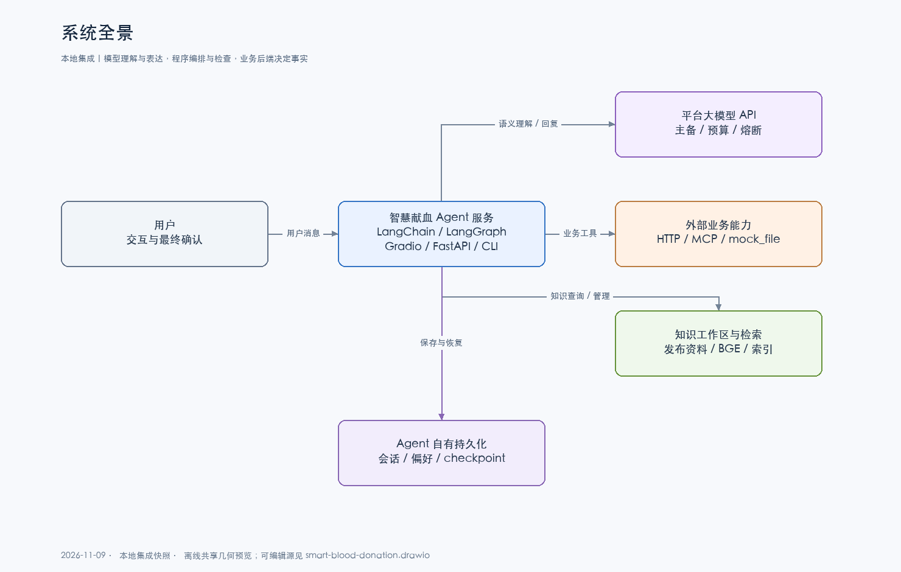

# 血站智慧献血导航

基于 **LangChain + LangGraph** 的多智能体应用，用于巩固工程实践和构建作品集。通过自然语言完成献血预约、爱心积分兑换、记录查询和知识问答；模型负责理解与表达，程序负责状态、约束和工具执行，业务结果以接口回执为准。

> **版本范围**　本次 `dev` 只更新文档与图册。下图、功能清单和进阶配置展示 2026-11-09 的本地集成快照。GitHub `dev` 的运行代码仍是此前版本，完整 PDF 管理页、统一的三种业务模式和顺序任务队列等功能代码尚未随此次文档提交。使用已提交代码时，以同分支的 [`.env.example`](.env.example) 和 `pyproject.toml` 为准。



## 功能

- **献血预约**：信息收集、网点澄清、完整预览、确认提交、预约查询、取消与签到。
- **爱心积分与纪念品**：余额、推荐、图文目录、兑换、订单状态、收货地址和订单取消。
- **献血记录与知识问答**：个人记录查询；按需组合业务查询、RAG证据和日期计算。
- **对话与知识库管理**：聊天历史、标题摘要、偏好与兴趣画像、标准问答缓存；资料上传、切分预览、召回测试和发布索引。
- **工程能力**：HTTP / MCP / 文件三种业务模式，平台模型主备容灾、会话隔离、追踪日志与批量评测。

当前仍有固定词/正则语义校正；统一临时确认队列与职责整理为待实现任务。内容风控默认暂停；OCR与LoRA暂缓。本项目不部署本地生成式大模型。

## 快速开始

需要 Python 3.10+，建议使用已验证的 Python 3.12。

```bash
python3.12 -m venv .venv312
.venv312/bin/python -m pip install -e '.[api,ui,mcp]'
cp .env.example .env
```

编辑 `.env`：填写模型平台的 `OPENAI_API_KEY`、`OPENAI_BASE_URL` 和 `OPENAI_MODEL`。这些变量表示 OpenAI 兼容协议，也可接入其他兼容平台。

GitHub `dev` 的运行代码默认使用 `http`，需要配置可访问的业务服务地址。若已在本地集成新版三种模式，可选择下列文件业务模式，直接使用合成数据：

```dotenv
BLOOD_AGENT_BUSINESS_TRANSPORT=mock_file
BLOOD_AGENT_MOCK_STATE=./.local/business.json
VECTOR_BACKEND=memory
```

完整业务对话需要有效模型配置。没有模型时，页面可以启动，业务答复会返回服务不可用。

```bash
.venv312/bin/python -m blood_agents.web
```

打开 **http://127.0.0.1:7861**。本地集成版本的页面提供聊天和 RAG 知识库管理，演示用户默认为 `U1001`。文件模式的业务资料来自独立合成种子，切换后端不会迁移已有订单或地址。

可选入口：

```bash
.venv312/bin/python -m uvicorn blood_agents.api:app --host 127.0.0.1 --port 8000
.venv312/bin/python -m blood_agents.cli
```

## 知识库

启用本地BGE编码、FAISS/Milvus和PDF解析：

```bash
.venv312/bin/python -m pip install -e '.[rag,rag_ingest]'
```

本地集成版本的知识库按「上传完整原件或摘录 → 核对提取并确认清洗 → 切分预览与召回测试 → 人工确认 → 构建并发布索引」使用。草稿不参与聊天。`memory` 是轻量词面检索。向量模式配置和操作见下方文档。

## 开发与验证

```bash
.venv312/bin/python -m pip install -e '.[dev]'
PYTHONPYCACHEPREFIX=/private/tmp/blood-agent-pycache .venv312/bin/python -m pytest -q
.venv312/bin/ruff check .
```

功能回归、真实模型对话评测和并发压测分别记录，测试替身结果不能当作平台性能。示例使用合成资料，不接入公司生产系统；演示入口的可编辑用户ID不能代替生产认证。

## 文档

| 内容 | 入口 |
| --- | --- |
| 架构、数据边界与组件 | [架构说明](docs/ARCHITECTURE.md) / [可编辑图册](docs/diagrams/smart-blood-donation.drawio) |
| 安装、配置和排障 | [配置指南](docs/CONFIGURATION.md) |
| 基础版本操作与代码阅读 | [操作示例](docs/DEMO_WALKTHROUGH.md) / [代码解读](docs/CODE_WALKTHROUGH.md) |
| 业务接口模式 | [HTTP / MCP / 文件模式](docs/BUSINESS_MODES.md) |
| 知识库管理与检索 | [页面流程](docs/RAG_MANAGEMENT_UI.md) / [RAG架构](docs/RAG_ARCHITECTURE.md) |
| 自动化评测与压测 | [多轮 Excel 评测](docs/CONVERSATION_EVAL.md) / [吞吐计划](docs/THROUGHPUT_PLAN.md) |
| 项目状态与验证记录 | [PROJECT.md](PROJECT.md) / [历史实现与验证证据](docs/PORTFOLIO_EVIDENCE.md) |
