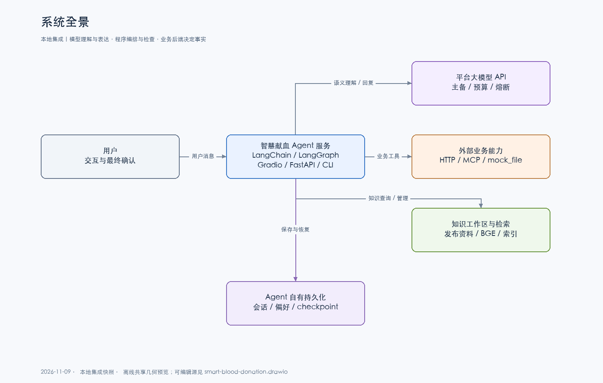

# 血站智慧献血导航：架构说明

2026-11-09 本地集成快照。架构采用 **LangGraph Supervisor/Worker、领域子图和有界只读模型循环**。本次 GitHub `dev` 提交只发布图册和说明。下列本地集成模块与此前已发布的运行代码存在版本差异，计划项单独标注。

项目用于巩固多智能体工程实践和构建可运行作品集。业务场景覆盖献血预约、爱心积分与纪念品、个人记录和知识问答；旧业务系统内部库存结算等规则不作为Agent主线。

## 系统边界

模型通过第三方平台的OpenAI兼容API接入。Agent查询当前业务事实、管理流程和组织答复；业务接口决定实际预约、订单、积分和记录。Agent自有库仅保存对话与流程相关数据。

[可编辑图册](diagrams/smart-blood-donation.drawio) · [离线图册](diagrams/index.html) · [全部图及源码依据](diagrams/README.md)。PNG/SVG是同源离线预览，不是draw.io原生导出；Mermaid源适用于支持它的文档阅读器。

## 组件清单

| 组件 | 当前职责与代码 |
| --- | --- |
| 交互入口 | [`web.py`](../blood_agents/web.py) Gradio聊天/RAG管理，另有 [`api.py`](../blood_agents/api.py) 与 [`cli.py`](../blood_agents/cli.py) |
| 会话边界 | [`ConversationGraph`](../blood_agents/orchestration/conversation.py) 将user_id/session_id转换为隔离线程键，同会话串行并关联trace_id |
| 主图与注册 | [`graph.py`](../blood_agents/orchestration/graph.py) 编译主图和五个注册子图；[`AgentRegistry`](../blood_agents/orchestration/agent_registry.py) 统一能力目录、schema和路由映射 |
| 预约领域 | [`appointment.py`](../blood_agents/domains/appointment.py) 收集、网点澄清、预览、确认提交及查询/取消/签到 |
| 积分领域 | [`points.py`](../blood_agents/domains/points.py) 余额、推荐、兑换、订单和地址；写操作分阶段确认 |
| 记录领域 | [`records.py`](../blood_agents/domains/records.py) 仅查询入口用户记录，全血与机采分单位表达 |
| FAQ领域 | `blood_agents/domains/faq.py` 委托本地集成的 `blood_agents/llm/query_agent.py` 按工具目录执行模型、工具、观察循环 |
| OCR注册项 | [`ocr.py`](../blood_agents/domains/ocr.py) 保留原型，真实图片入口与引擎暂缓；不计入四个活动领域 |
| 工具与后端 | `ToolRegistry` 注册 19 项工具，本地集成的 `blood_agents/business/transport.py` 选择 HTTP、MCP 或文件模式 |
| 模型池 | [`ModelGateway`](../blood_agents/llm/model_gateway.py) 主备、预算、熔断、在途限制；多个阶段可复用同一池，未为每个Agent部署独立模型 |
| 回复与检查 | [`ReplyComposer`](../blood_agents/llm/reply_composer.py) 用结构化事实生成回复并做关键检查；内容风控默认暂停 |
| 知识检索 | `HybridRetriever` 做词面及可选向量召回，本地集成的 `blood_agents/knowledge/workspace.py` 管理草稿、清洗和发布 |
| 会话与记忆 | [`AgentRepository`](../blood_agents/storage/repository.py) 的六类SQLAlchemy表；独立 [`SQLAlchemySqliteSaver`](../blood_agents/storage/checkpoint.py) 保存图状态 |
| 评测与观察 | [`evals/`](../blood_agents/evals/) 的固定多轮Excel与模型评审，JSONL追踪、服务入口压测和HTML报告 |

工具数19包含暂缓的 `ocr_extract`，不等于19个生产系统已接通。FAQ内置 `date_offset` 不在该19项中。详细名称来自图册的自动AST目录。

## 一轮消息与多轮任务

1. 入口提供user_id、session_id和用户原话，ConversationGraph设置追踪上下文、取得会话锁并恢复checkpoint。
2. 主图先检查人工审核的标准问答缓存；只在完整唯一命中、未过期且不依赖个人/实时事实时直接回复。
3. 未命中则由supervisor模型根据动态能力目录识别领域、账户范围与任务片段。跨账号请求在派发前拒绝；对话不能更改入口身份。
4. 预约/积分子图理解本轮参数，读取业务事实并推进自己的状态。记录子图只读查询；FAQ按观察循环选择所需查询和计算。
5. 领域节点返回结构化结果，ReplyComposer调用模型表达；关键检查失败时可在同一批事实下重写，不重放业务写入。
6. handoff保留等待状态或回交主导航。状态进入checkpoint，对话另存入会话表；标题/摘要、兴趣画像按入口的后续事件更新。

子图每轮走到END，再由下一轮恢复继续；这里没有以原生interrupt维持一个长期等待的模型请求。

多任务由本地集成的 `blood_agents/orchestration/task_queue.py` 按顺序派发，默认最多五个用户任务。一个任务需要用户补充或确认时暂停队列，完成后接续剩余任务。各领域保留自己的模型回复，队列状态随会话保存。

## 预约状态与确认

`appointment_state` 是权威草稿，`slots` 为兼容副本；`active_agent`/`agent_status` 说明控制权，`result` 表示本轮结果。模型动作action与业务成功状态不同。

| 场景 | 当前状态表达 |
| --- | --- |
| 收集时间、网点、献血人 | collecting＋已收集字段＋result.missing，无固定填写顺序 |
| 未匹配网点 | site_selection_pending＋site_clarification_required，确认明确候选后继续收集 |
| 完整资料 | awaiting_confirmation＋完整预览；回复可交付后标记preview_delivered |
| 确认提交 | 重新核验字段契约和实时号源，带入口身份、资料与幂等键调用submit_appointment |
| 成功/拒绝 | 以接口success/code/data为准；字段不足可回收集，部分其他失败结束草稿 |

当前确认仍包含固定词与正则校正；不是已经统一的语义确认队列。`completed` 只表示流程结束，成功、失败或退出都可能到达；预约成功必须有接口回执。

## 三种业务模式

`BLOOD_AGENT_BUSINESS_TRANSPORT` 是唯一选择项：HTTP全部调用HTTP客户端；MCP全部业务操作经MCP客户端；mock_file直接调用独立文件实现。不存在“配置MCP但部分写入偷偷走HTTP客户端”的客户端混用，也不因错误自动切换业务后端。

MCP Server本身可以选择HTTP适配器或文件后端，支持stdio和Streamable HTTP。HTTP嵌套是兼容既有系统的一种后端选择，并非MCP协议要求。切换模式不会迁移旧订单、地址或积分。

本机 HTTP 演示有两个进程。Gradio 默认在 `7861`，业务替身默认在 `8001`。`query_sites` 经过 HTTP 读取业务排班，追踪标为 `legacy_http`。本机演示业务服务启动时生成排班，更新种子后需重启业务进程。端口检查、后台日志和排班排查见 [业务模式](BUSINESS_MODES.md)。

当前个人工具在请求前校验可信入口身份，模型不可提供或覆盖user_id。演示入口仍依赖上游认证假设，不是完整的生产身份认证系统。

## RAG、数据与记忆

上传支持完整的可提取文本 PDF。解析保留原件和物理页码，确认清洗后的正文才生成片段。四种切分和临时召回测试独立于正式索引。人工确认评测并发布后，当前实例刷新活动检索快照。草稿不参与聊天，随包语料清单在本地集成版本为空。跨进程发布同步与生产权限治理仍待实现。

默认memory仅做词面重合检索。向量模式使用本地bge-large-zh-v1.5编码，后端为FAISS或Milvus；当前融合是词面分数与过阈值向量分数相加，**不是BM25或RRF**。可选bge-reranker只排序已通过召回门槛的候选。证据核验与内容风控是不同组件，后者当前默认暂停。详见 [RAG架构](RAG_ARCHITECTURE.md)。

Agent会话库、checkpoint文件、JSONL追踪、RAG工作区/向量库、外部业务数据分开存储。短期记忆投影流程，长期偏好和兴趣画像有来源/隐私门禁；摘要和偏好不代表实时业务事实，不构成提交授权。静态问答缓存不存个人余额、库存或预约结果。

## 容灾、并发与风险

- 主备平台独立配置；默认单次模型调用主40秒、备20秒、总预算60秒，不是整轮响应时限。线程等待超时不保证底层请求已取消。
- 同会话串行、跨会话可并行，主备各有单进程在途限制。当前没有Redis协调、多Worker一致性或分布式队列。
- 保守流式只适用于符合条件的general回复；业务和FAQ在完整生成与校验后显示。30字分段审查与生成中断尚未实现。
- 内容风控默认passthrough；确定性事实与隐私检查继续运行，仍可能误拦或漏判，不能宣称通用幻觉消除。
- 知识元数据可辅助模型判断，但没有硬性的地区/有效期/版本冲突解析或租户权限过滤。
- 注册表、schema和一次JSON工具计划不是独立Skill加载系统；当前工具决策不是原生tool_calls。
- 本地或历史小样本验证不代表生产容量，实际验证环境与局限见 [证据矩阵](PORTFOLIO_EVIDENCE.md)。

## 待实现视图

[第12页：统一临时确认](diagrams/12-planned-confirmation.png) 只描述任务3l/3m。正常资料收齐直接总确认，歧义才进入临时队列；模型理解接受/拒绝/修改，程序管理事项、来源、约束和版本。修改使旧最终确认失效，不能因为同句含“确认”就提交。详见 [唯一项目计划](../PROJECT.md)。
