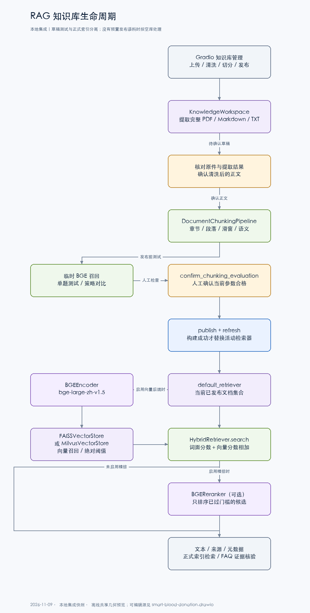

# RAG：资料处理、检索与证据

2026-11-09 本地集成快照。以下描述按本地知识模块与只读编排代码核对。GitHub `dev` 此次发布文档与图册，管理页及只读循环的新增代码仍在本地集成。

## 资料进入系统

Gradio 管理页由本地集成的 `blood_agents/knowledge/workspace.py` 管理 PDF、Markdown 和 UTF-8 TXT。工作区默认是 `.local/rag/`，保存原件、提取正文、清洗稿、清单和评测状态。该集成版本的随包语料清单为空。下载到 `data/knowledge_sources/` 的原始材料需要经过确认和发布才会进入聊天检索。

页面依次处理上传、提取、清洗确认、切分预览、单题或策略对比、人工确认评测和索引发布。完整文本 PDF 可直接上传，提取时保留物理页码并标记需核对的字符。来源链接、审核备注和适用范围可留空。

本地集成的 `blood_agents/knowledge/chunking.py` 提供章节与段落、段落合并、固定滑动窗口和基于本地 BGE 的语义分段。参数使用字符长度、重叠和语义阈值，保留 PDF 页码、章节路径和片段 ID。扫描页不执行 OCR。

## 草稿测试与正式索引

单题/策略对比用当前草稿片段建立临时BGE向量，不写Milvus，不让草稿参与聊天。人工确认只对应本次切分参数；修改参数后旧测试结论失效。发布构建成功后替换当前实例的检索器快照，失败则保留原快照并回退资料状态。撤回保留原文件但移出活动知识集合。

管理页刷新的是当前实例；多进程/多实例之间的发布同步尚未实现，单独启动API不能默认视为已收到另一个网页进程的热更新。

## 编码、索引与精排

| 配置 | 实际行为 |
| --- | --- |
| `VECTOR_BACKEND=memory` | 内存中的词面重合分数，无向量库、无默认BGE下载 |
| `VECTOR_BACKEND=faiss` | BGE编码，FAISS索引；运行实例内构建/复用 |
| `VECTOR_BACKEND=milvus` | BGE编码，Milvus Lite本地文件或远端端点；当前本机Lite已有历史验证 |
| `EMBEDDING_MODEL` | 默认 `BAAI/bge-large-zh-v1.5` |
| `RAG_RERANKER=bge` | 可选 `BAAI/bge-reranker-base` CrossEncoder排序；默认none |

Milvus Collection保存片段向量、片段标识及关联检索信息，内容和模型指纹用于区分索引版本。实际字段与连接设置见 [`adapters.py`](../blood_agents/knowledge/adapters.py)。本地文件配置使用 `RAG_MILVUS_URI`；不要使用pymilvus自身只接受网络地址的 `MILVUS_URI` 承载本地路径。

空知识库不创建空Collection或加载BGE。当前后端是选择关系，不会同时检索FAISS和Milvus再做跨库融合。

## 召回算法

[`HybridRetriever.search`](../blood_agents/knowledge/rag.py) 先计算词面匹配分数：查询与正文的中文字符/英文数字词项交集，除以两集合大小乘积的平方根。向量模式再召回约 `top_k * 2` 候选，过滤非法或低于绝对阈值的向量分数，并加到同一片段的词面分数上。

候选排序后先过召回门槛，再由可选BGE重排器调整顺序；重排分数不能把弱召回自动变成可靠证据。返回片段正文、分数、标题、来源、日期与溯源信息。

**当前没有BM25、RRF或跨向量库联邦检索。**默认阈值是调试起点，不能解释为医学可靠概率。

发布资料汇合到当前文档集合，同一问题可能命中多份资料。地区、版本、有效期和审核备注会提供给模型辅助判断，但没有硬性的冲突优先级、自动废止、租户权限过滤或自动法律有效性判断；冲突、缺失条件需要保留为证据缺口。

## 用户提问到答案

主导航将知识与只读组合问题交给 FAQ。本地集成的 `blood_agents/llm/query_agent.py` 让模型根据工具目录和当前观察，选择知识检索、个人业务查询、受控日期运算或结束。默认最多八个决策步骤。格式错误可触发重试，实际 API 请求数还受重试与主备切换影响。

`knowledge_search` 返回的知识经过 [`EvidenceAssessor`](../blood_agents/knowledge/evidence.py) 检查支持范围和缺口；这是知识证据核验，不是暂停的内容风控模型。缺链接不等于缺证据；缺正文依据不能凭语言能力补造规则。

计算下次献血参考日期时，模型自行选择个人记录和适用规则，`date_offset` 验证被引用的记录日期、规则原文、时长和单位后运算。没有为“下次献血”关键词硬编一条查询序列。计算工具不能替模型保证选对规则，最终仍需真实多轮评测。

ReplyComposer把用户问题、实际观察、经核验片段和计算结果交给回复模型；不把知识片段当成指令。空库、检索失败、证据不足和核验不可用是不同情况，不应统一说成“知识库没有答案”。

## 评价与局限

管理页召回测试只回答“命中哪些片段”，核验词只做文本检查，不代表最终模型答复正确。固定多轮Excel测试检查节点、工具、回执和对话目标；模型评审是另一层结果。历史指标需带数据集、指纹、环境和限制，见 [证据矩阵](PORTFOLIO_EVIDENCE.md)。

操作见 [知识库管理页](RAG_MANAGEMENT_UI.md)，文件处理见 [入库说明](RAG_INGEST_WALKTHROUGH.md)，系统边界见 [架构说明](ARCHITECTURE.md)。
